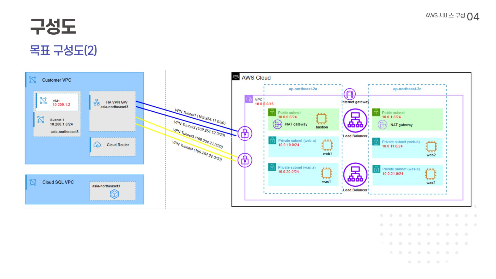
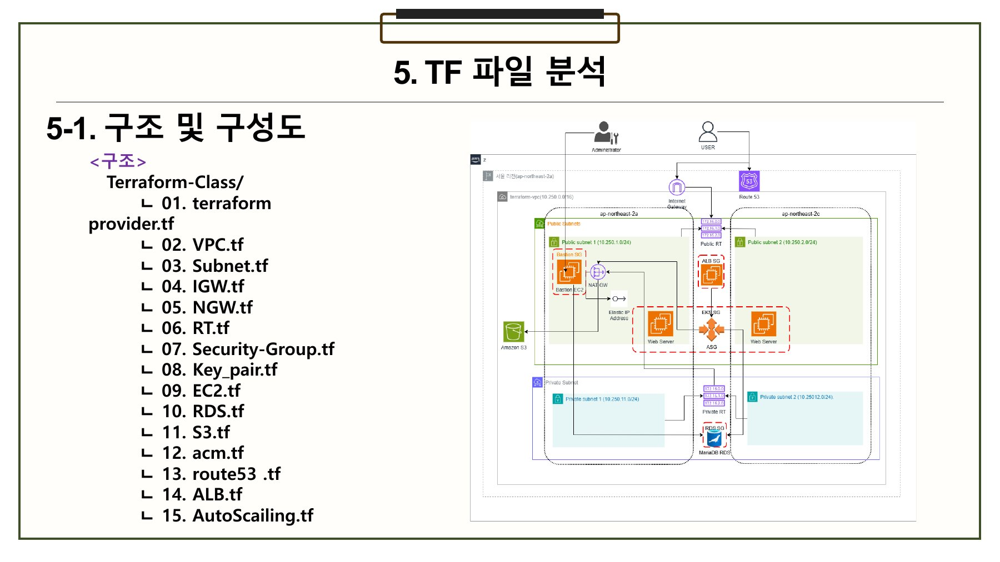
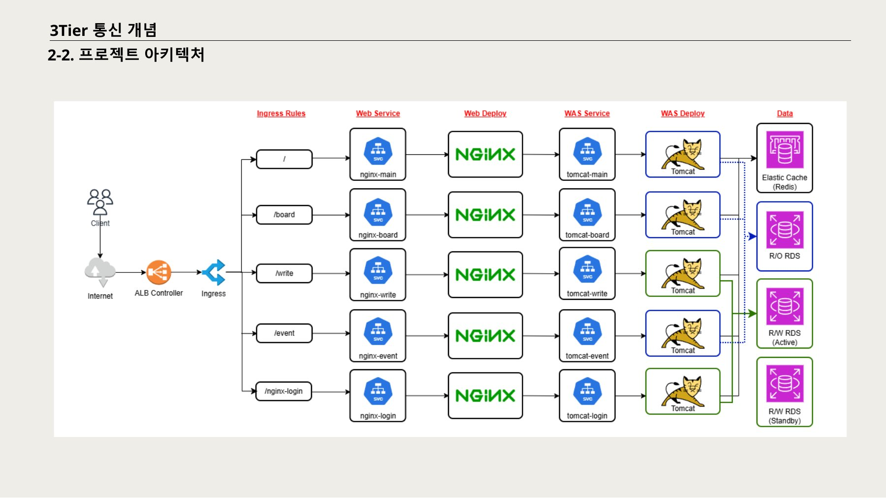
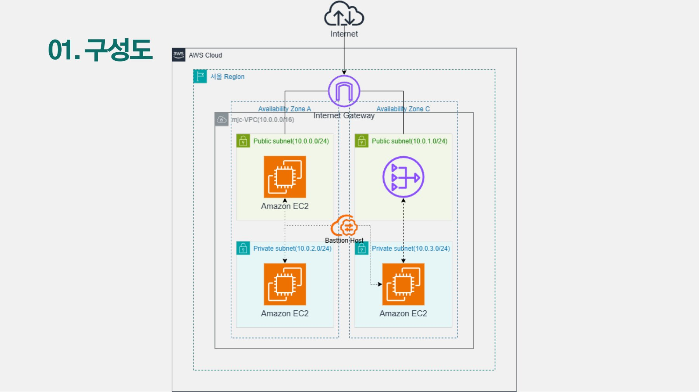
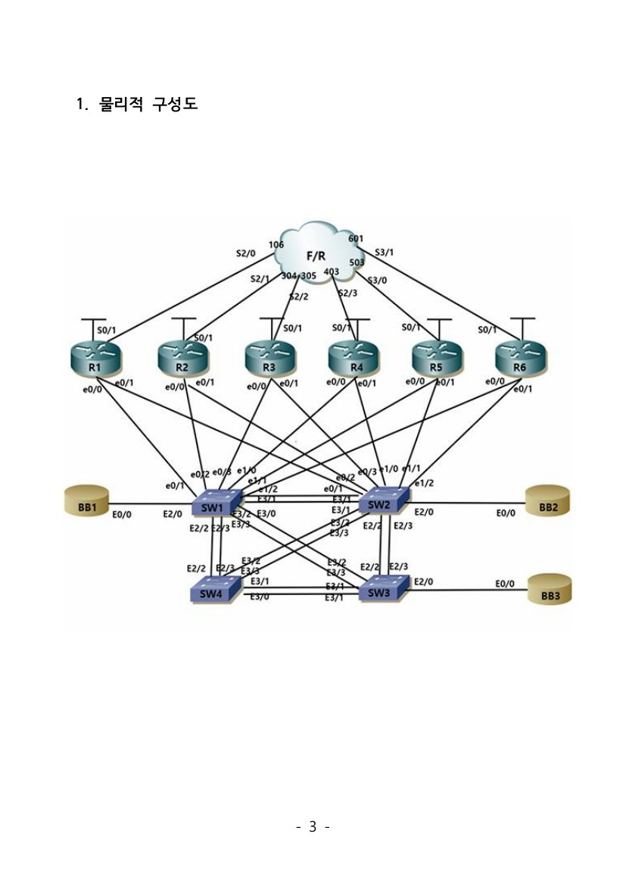
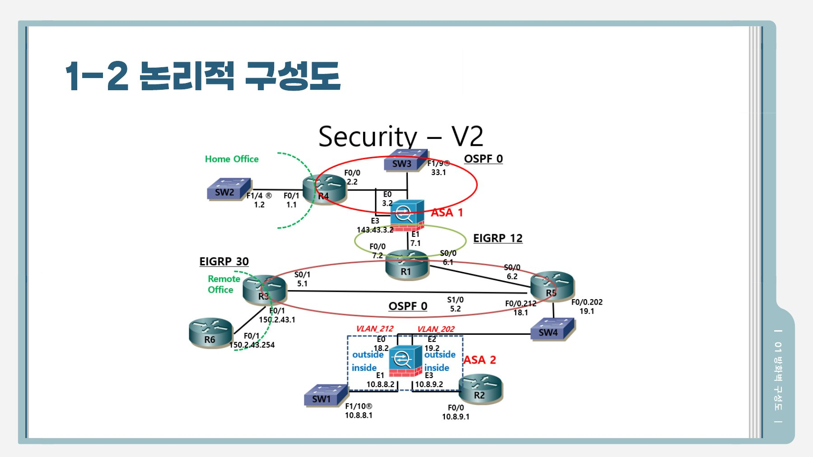

# 한준영 | Cloud / Infrastructure Engineer (신입)

> 코드로 인프라를 다루는 클라우드 엔지니어를 목표로 합니다.
> AWS · Google Cloud 환경을 **Terraform(IaC)** 으로 구축·자동화하는 실습 프로젝트를 진행했습니다.

## Tech Stack

| 분야 | 도구 | 경험 | 수준 |
|---|---|---|---|
| Cloud Platforms | AWS, Google Cloud | AWS(3Tier, ECS, Multi-Cloud, VPN), GCP(VPN, Cloud SQL, Multi-Cloud) | 중 |
| IaC | Terraform | Multi-Provider 인프라 프로비저닝 | 중하 |
| Container & OS | Kubernetes, Linux | Rocky Linux(디스크 추가, 쿼터, 서버 구성), Kubernetes(Pod 스케일링, Cluster 구성) | 중하 |
| Networking | Cisco Packet Tracer, IOU-Web | VLAN 구성, Routing Protocol 제어, 방화벽 설정 | 중 |

## Projects

대부분 4인 팀 프로젝트로 진행했으며 팀장을 맡았습니다. 각 프로젝트의 상세 보고서(PDF)는 [`docs/`](docs) 폴더에 있습니다.

| 프로젝트 | 핵심 기술 | 보고서 |
|---|---|---|
| [Multi-Cloud (AWS ↔ GCP)](#1-multi-cloud-aws--gcp) | Terraform, AWS, GCP, HA VPN, Cloud SQL | [PDF](docs/multi-cloud-terraform-aws-gcp.pdf) |
| [Terraform-AWS](#2-terraform-aws) | Terraform, Terraform Cloud, GitHub, AWS | [PDF](docs/terraform-aws.pdf) |
| [AWS 3Tier 아키텍처](#3-aws-3tier-아키텍처) | VPC, ALB, Route 53, NGINX, Tomcat, RDS | [PDF](docs/aws-3tier.pdf) |
| [AWS 개인 프로젝트](#4-aws-개인-프로젝트-vpc--bastion) | VPC, NAT Gateway, Bastion Host | [PDF](docs/aws-personal-vpc.pdf) |
| [Kubernetes](#5-kubernetes-cka-실습) | kubeadm, RBAC, NetworkPolicy, PV | [PDF](docs/kubernetes-cka-practice.pdf) |
| [Rocky Linux 서버 구축](#6-rocky-linux-서버-구축) | LVM, Quota, DNS/Web/FTP/NFS/Samba/DHCP/Mail/DB | [PDF](docs/rocky-linux-server.pdf) |
| [Cisco 네트워크](#7-cisco-네트워크-랩) | Frame Relay, VLAN, STP, OSPF/EIGRP/RIP, HSRP | [PDF](docs/cisco-network-lab.pdf) |
| [Cisco ASA 방화벽](#8-cisco-asa-방화벽) | ASA Multi-Context, ACL, MPF, Object NAT | [PDF](docs/cisco-asa-firewall.pdf) |

---

### 1. Multi-Cloud (AWS ↔ GCP)

Terraform으로 AWS 환경을 구축하고, **Site-to-Site HA VPN**으로 Google Cloud와 연결한 뒤 AWS Bastion Server를 통해 GCP **Cloud SQL**에 접속하는 멀티클라우드 프로젝트입니다.

- **GCP**: VPC(`multinet`, 서울 리전), 방화벽 규칙, Bastion VM(Rocky Linux), Cloud SQL(MySQL 8.0, Private IP) 구성
- **AWS**: Terraform 코드로 VPC, ALB, 웹/WAS 서버 구성, Route 53 및 도메인 연결
- **VPN**: GCP HA VPN Gateway + Cloud Router(BGP) ↔ AWS Virtual Private Gateway / Customer Gateway, VPN 터널 2개 구성
- **DB 연동**: Cloud SQL 전파 대역을 Cloud Router에 추가, Route 53 Private 레코드(`db.cloud.local`)로 접속, Bastion에서 테이블 생성·조회 확인
- **결과**: 도메인으로 웹 서비스 접속 및 로그인 정상 동작 확인
- **역할**: 팀장 · Terraform 코드 이해, AWS 및 GCP 실습

### 2. Terraform-AWS

Terraform 코드로 AWS 인프라를 구축하고 **GitHub → Terraform Cloud → AWS** 로 이어지는 자동화 흐름을 구성했습니다.

- **환경 구축**: Terraform, AWS CLI, VS Code(HashiCorp Terraform 확장)
- **코드 구성 (15개 `.tf` 파일)**: provider, VPC(`10.250.0.0/16`), Subnet(Public/Private × 2a·2c), IGW, NAT GW, Route Table, Security Group, Key Pair, EC2, RDS(MariaDB), S3, ACM, Route 53, ALB, Auto Scaling
- **워크플로우**: `init` → `validate` → `plan` → `apply` → `destroy`
- **연동**: GitHub Repository + Terraform Cloud 연동, Terraform Cloud ↔ AWS 연결, Route 53 호스트 영역 및 도메인 NS 등록
- **역할**: 팀장 · PPT 제작, Terraform 코드 이해 및 설명

### 3. AWS 3Tier 아키텍처

웹(NGINX) – WAS(Tomcat) – DB(RDS) 3계층 구조를 AWS 위에 직접 구축했습니다.

- **네트워크**: VPC, Public/Private Subnet(2a·2c), IGW, NAT GW, 라우팅 테이블
- **보안**: 보안그룹 분리(Public/Private), Bastion 서버를 통한 Private 서버 접속 (Bastion 외 서버는 모두 Private Subnet 배치)
- **트래픽**: ALB + 대상 그룹, Route 53 레코드, HTTPS(ACM 인증서)
- **서비스**: Public Subnet에 NGINX, Private Subnet에 Tomcat 설치 후 NGINX ↔ Tomcat 연동, 도메인 접속 확인
- **역할**: 팀장 · AWS 실습, PPT 제작

### 4. AWS 개인 프로젝트 (VPC + Bastion)

- VPC(`10.0.0.0/16`) 아래 Public/Private Subnet 각 2개(서울 리전, 2개 AZ) 구성
- Internet Gateway, NAT Gateway, 라우팅 테이블, 보안그룹 구성
- Bastion Host를 통해 Private 인스턴스에 SSH(키페어)로 접속 확인

### 5. Kubernetes (CKA 실습)

자격증(CKA) 시험 유형의 문제를 직접 풀며 정리한 실습 보고서입니다. 문제별 풀이 절차와 명령어를 기록했습니다.

- **ETCD**: 스냅샷 백업/복원
- **Cluster 업그레이드**: kubeadm으로 `1.34.7` 업그레이드 (drain → upgrade → uncordon)
- **RBAC**: ServiceAccount, Role/RoleBinding, ClusterRole/ClusterRoleBinding
- **노드 관리**: drain/uncordon, nodeSelector 스케줄링
- **Pod**: 환경변수·command·args, Static Pod
- **배포**: Rolling Update & Rollback
- **네트워크/스토리지**: NetworkPolicy, emptyDir, HostPath, PersistentVolume
- **역할**: 팀장 · 보고서 및 코드 작성

### 6. Rocky Linux 서버 구축

Rocky Linux 서버 3대(VMware)를 설치하고 주요 서비스를 직접 구축했습니다.

- **기본 설정**: 고정 IP 설정, 사용자/그룹 생성 및 등록
- **스토리지**: 디스크 추가 후 파티션 → LVM(PV/VG/LV) 구성, 디스크 쿼터 설정
- **서비스 구축**: DNS(named), Web(httpd), FTP(vsftpd), NFS, Samba, DHCP, Mail(sendmail), MariaDB
- **보안**: 서비스별 `firewalld` 허용 규칙 적용, Samba용 SELinux 설정
- **역할**: 팀장

### 7. Cisco 네트워크 랩

Cisco 자격증 실기 유형의 시나리오를 IOU-Web 환경에서 구성했습니다.

- **Switching**: Frame Relay(point-to-point / multipoint sub-interface), Trunk, VLAN별 Load Balancing(홀수/짝수), EtherChannel, Spanning-tree Tuning, Errdisable
- **Routing**: RIPv2, OSPF(Stub Area, Route Reduction), EIGRP, 경로 재분배(Redistribution)
- **IP Services**: NTP, HSRP, Syslog
- **Security**: 스위치 보안, Telnet 설정
- **검증**: 라우팅 테이블, VTP, VLAN 정보 확인
- **역할**: 팀장 · 코드 작성 및 이해

### 8. Cisco ASA 방화벽

Cisco 자격증 방화벽 문제를 기반으로 ASA 2대와 스위치·라우터 환경을 구성했습니다.

- **스위치/라우터**: SW1~4(VLAN 212/202, Trunk), R1~R6(OSPF·EIGRP 라우팅)
- **방화벽 1**: 인터페이스 보안 레벨(inside/outside), Redundant Interface, 라우팅, **MPF**(ICMP inspection)
- **방화벽 2**: Active Key 설정 후 **Multiple Context**(admin/C1/C2) 분리, 컨텍스트별 ACL·라우팅, **Object NAT**(Static / Dynamic)
- **검증**: 내부↔외부 Ping 테스트로 정책 적용 전후 비교
- **역할**: 팀장 · 코드 작성 및 이해

---

## Education

- **명지전문대학** 전자공학과 (2027.02 졸업 예정)

## Training

- **대우능력개발원** — 클라우드 기반 정보시스템 구축 (6개월)

## Certifications

| 자격증 | 발행처 | 취득 |
|---|---|---|
| 네트워크관리사 2급 | 한국정보통신자격협회 | 2026.05 |
| 리눅스마스터 2급 | KAIT | 2026.07 |
| 자동차운전면허증 1종 자동 | 서울특별시경찰청장 | 2026.08 |

## Activities

- 임베디드 캡스톤 디자인 (명지전문대, 2026.03 ~ 2026.07)
- 인공지능 캡스톤 디자인 (명지전문대, 2026.03 ~ 2026.07)
